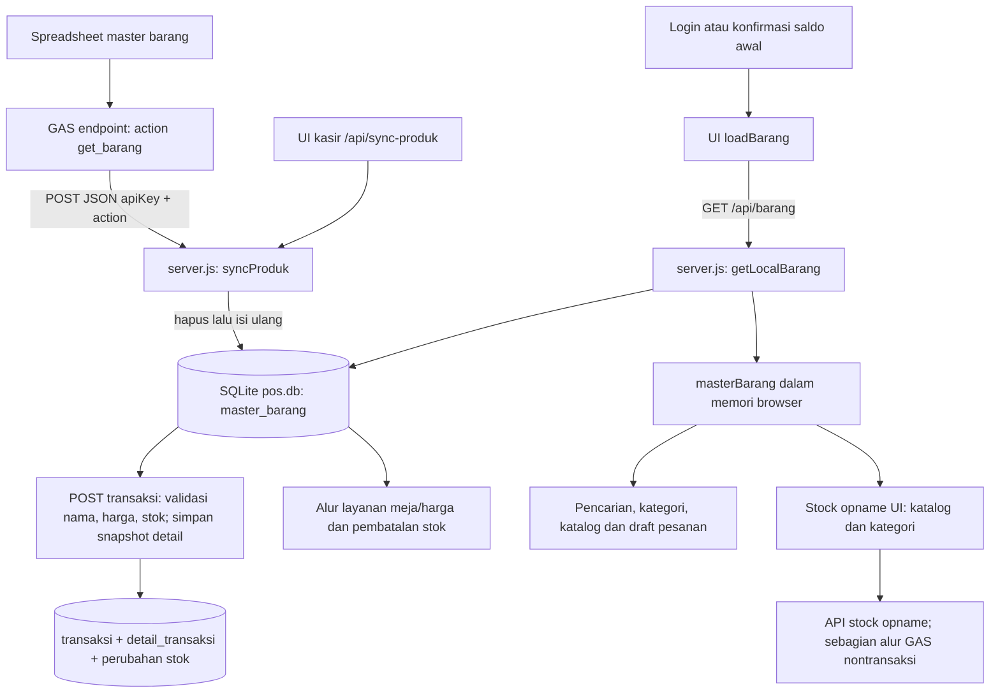

# Audit alur Master Barang PBMS dan rancangan migrasi

> **Pembaruan status (2026-10-02):** bagian ketergantungan GAS di bawah adalah hasil audit historis. Pemanggilan katalog/harga dan SO legacy telah dinonaktifkan/dihapus dari runtime. Lihat [PBMS-GAS-MIGRATION.md](PBMS-GAS-MIGRATION.md) untuk status terkini. Database aktif tidak dikosongkan, identitas produk lokal dipertahankan, dan spreadsheet tidak disentuh.

Tanggal audit: 1 Oktober 2026  
Cakupan: kode aktif di root dan `www/`; backup, APK hasil build, serta arsip historis tidak diperlakukan sebagai runtime.

## Ringkasan temuan

PBMS **sudah memiliki tabel master barang di SQLite lokal (`pos.db`)**. Aplikasi membaca katalog dari SQLite, bukan meminta spreadsheet pada setiap pencarian atau transaksi. Spreadsheet diakses melalui Google Apps Script (GAS) dengan aksi `get_barang` saat kasir menjalankan sinkronisasi produk. Dengan demikian, pekerjaan migrasi yang tepat adalah memindahkan sumber otoritatif master dari spreadsheet/GAS ke database dan mengganti proses refresh, sambil mempertahankan kontrak `/api/barang` serta perilaku transaksi.

SQLite lokal juga dipakai sebagai penyimpanan transaksi dan stok produksi. Jangan mengganti atau memigrasikan basis data transaksi sebagai bagian dari perpindahan sumber master. `MIGRATION_BASELINE.md` menyatakan transaksi penjualan dan pembatalan berjalan lokal di SQLite; catatan ini adalah baseline terdokumentasi, bukan verifikasi ulang runtime produksi saat audit.

## 1. Alur sistem sekarang



### Urutan pemanggilan

- Saat aplikasi web memulihkan sesi kasir yang valid, `index.html` memanggil `loadBarang()` setelah sesi/shift dan saldo awal dinyatakan siap. Login baru melakukan hal sepadan setelah konfirmasi saldo awal. Ini bukan pemuatan pada proses startup server.
- `loadBarang()` meminta `GET /api/barang`, menyimpan seluruh response `data` ke array global `masterBarang`, kemudian merender kategori dan katalog. Pencarian katalog berikutnya memfilter array itu di browser; tidak melakukan query spreadsheet atau request API per karakter.
- `GET /api/barang` membaca SQLite lewat `getLocalBarang()`. Endpoint juga mendukung query `?q=`, tetapi UI katalog aktif mengambil data utuh lalu memfilter lokal.
- Kasir memilih **SYNC PRODUK** secara eksplisit untuk `POST /api/sync-produk`. Server meminta GAS `action: "get_barang"`, mengganti tabel lokal, lalu endpoint melakukan sinkronisasi cache harga member terpisah. UI memanggil ulang `loadBarang()` setelah sync berhasil.
- Endpoint transaksi membaca ulang master lokal pada sisi server. Harga jual/HPP disalin ke `detail_transaksi` sebagai snapshot transaksi. Validasi stok dan harga saat transaksi karena itu tidak bergantung pada array browser saja.
- Modul stock opname memuat `/api/barang` ketika modal dibuka. Stock opname memiliki API dan state sendiri; dokumentasi baseline menyebut GAS masih dipakai untuk aksi `proses_stock_opname` dan `finalize_stock_opname`.

### Cache dan perilaku perubahan

- Cache aktif: tabel SQLite `master_barang` bertahan melewati restart, dan array `masterBarang` bertahan dalam memori tab selama halaman aktif. Tidak ditemukan cache master barang memakai `localStorage`/`sessionStorage`.
- Data master berubah di aplikasi setelah sync manual GAS → SQLite dan reload katalog. Perubahan spreadsheet tidak otomatis tampak pada aplikasi sampai sinkronisasi dilakukan.
- Sinkronisasi saat ini menjalankan `DELETE FROM master_barang`, lalu insert baris satu per satu. Proses tidak tampak dibungkus transaksi DB. Error callback untuk tiap `stmt.run()` tidak diperiksa; kegagalan dapat meninggalkan katalog kosong/sebagian. Validasi response hanya mengecek `success === true` dan `data` array. Tidak ada pemeriksaan mencegah array kosong, ID/nama duplikat/kosong, harga/stok tidak finite/negatif, atau skema kolom yang berubah sebelum tabel lama dihapus.
- Bila sinkronisasi master berhasil tetapi sinkronisasi harga member gagal, API mengembalikan HTTP 500 dengan pesan yang menyatakan produk sudah tersimpan. Ini membuat hasil parsial antar-subproses dan perlu dipisahkan/diterangkan saat migrasi.

## 2. Field dan hubungan data

### Kontrak barang yang benar-benar dibaca aplikasi

| Field logis / API | Kolom SQLite sekarang | Penggunaan dan kewajiban |
|---|---|---|
| ID barang (`id`, diimpor dari `item.id`) | `id_barang` (text) dan `id` (PK lokal integer) | ID GAS disimpan sebagai `id_barang`, tetapi `getLocalBarang()` **tidak mengembalikannya**; response API mengembalikan PK lokal `id`. Stock opname mengirim `item.id` sebagai `idBarang`, jadi yang dipersistensikan SO sekarang adalah ID lokal, bukan `id_barang` sumber. PK lokal dapat berubah saat isi master diganti; verifikasi kontrak SO/GAS sebelum menetapkan kunci SQL baru. |
| `nama` | `nama TEXT NOT NULL` | Wajib untuk katalog, pencarian, lookup transaksi, pesanan meja, pembatalan stok. Saat ini transaksi mencocokkan nama tanpa ID; perubahan/duplikasi nama berisiko. |
| `kategori` | `kategori TEXT NOT NULL DEFAULT 'Lainnya'` | Dipakai untuk filter kategori dan klasifikasi barang meja/produk billiard; bisa diterapkan default. Stock opname memakai kategori sebagai area/kategori fallback. |
| `hpp` | `hpp INTEGER NOT NULL DEFAULT 0` | Dicatat sebagai snapshot detail transaksi dan pesanan meja; nilai default nol dapat diterima secara teknis, tetapi kebutuhan akuntansi harus ditetapkan. |
| `hargaJual` / `harga_jual` | `harga_jual INTEGER NOT NULL DEFAULT 0` | Dipakai di UI, validasi harga dan total transaksi, harga produk meja. Nilai nol sah untuk layanan/kasus khusus tertentu, jadi jangan menambahkan batas positif tanpa memilah jenis produk. |
| `stokAktual` / `stok_aktual` | `stok_aktual INTEGER NOT NULL DEFAULT 0` | Wajib secara bisnis untuk barang stok. Penjualan mengurangi stok; pembatalan menambahkannya. Nilai default nol ada di DB tapi membuat produk tidak bisa dijual jika tidak disinkronkan benar. |
| `updated_at` | `updated_at TEXT NOT NULL` | Diisi satu timestamp sync untuk semua barang, ditampilkan UI sebagai “Produk sync”. Bukan timestamp update per barang dari spreadsheet.

Field spreadsheet lain seperti barcode, satuan, supplier, pajak, status aktif, atau harga beli terpisah **tidak ditemukan sebagai field master barang yang dipakai kode aktif**. Audit ini tidak dapat memastikan apakah kolom tersebut ada di spreadsheet; kontrak sumber GAS dan header sheet perlu diperiksa dari sisi spreadsheet sebelum import.

### Relasi/pemakaian lintas modul

- **Penjualan:** `POST /api/transaksi` membaca master SQLite, mencocokkan produk berdasarkan nama (case/whitespace-insensitive), memvalidasi stok dan menggunakan harga/HPP DB. Baris detail menyimpan nama, qty, harga, HPP dan subtotal saat transaksi; riwayat/laporan menggunakan detail transaksi sehingga transaksi existing tidak semestinya dijoin ulang dengan master terkini.
- **Stok:** stok master diubah pada transaksi penjualan dan dikembalikan ketika transaksi dibatalkan. Stock opname mengambil master/kategori dari endpoint katalog, sementara status dan detail SO disimpan pada tabel tersendiri; baseline menyebut ada GAS pada proses/finalisasi SO. Migrasi master jangan mengubah alur sinkronisasi/finalisasi SO tanpa audit khusus.
- **Meja/harga:** kategori dan nama digunakan untuk menemukan item Meja Billiard/1 Jam; harga dan HPP normal diambil dari master lokal, sedangkan harga member berasal dari cache/aturan harga terpisah. Pesanan sesi menyimpan snapshot sendiri.
- **Kategori:** kategori teks biasa, tanpa tabel kategori/foreign key; dipakai filter UI, deteksi kategori berisi “meja”, serta stock opname.
- **Pembelian/supplier/barcode:** tidak ditemukan relasi aktif dari `master_barang` pada kode produksi yang ditelusuri. Tidak ada field master barcode/supplier pada skema yang ditemukan. Modul/fitur yang tidak ada di repo atau logika eksternal GAS tidak dapat disimpulkan dari pencarian kode lokal.
- **Laporan:** laporan penjualan memakai `detail_transaksi`/transaksi (snapshot historis), bukan membaca ulang field master untuk menghitung transaksi lama. Perubahan schema master tidak boleh mengubah detail transaksi yang sudah tercatat.

## 3. Ketergantungan spreadsheet dan file terkait

### Jalur aktif yang terkait langsung

- `config.js`: `GAS_URL` untuk endpoint GAS aktif dan API key konfigurasi. Detail rahasia/config tidak perlu disalin ke sistem baru.
- `gas.js`: `callGas()` mengirim POST JSON berisi API key dan data aksi ke GAS; tidak mem-parsing spreadsheet langsung.
- `server.js`: koneksi `pos.db`, inisialisasi tabel master (sekitar baris 400), `getLocalBarang()` (sekitar 1930), `syncProduk()`/`get_barang` dan penggantian isi tabel (sekitar 1953), endpoint `GET /api/barang` dan `POST /api/sync-produk` (sekitar 3200). Server juga memakai `master_barang` pada validasi transaksi, pembatalan stok, dan kalkulasi layanan meja.
- `index.html`: `loadBarang()`, state browser `masterBarang`, sinkronisasi tombol/UI, pencarian, kategori, pemilihan barang dan sejumlah kalkulasi tampilan.
- `stock-opname.js`: mengambil endpoint katalog saat modal dibuka, membuat kategori, memakai ID/kategori/stok barang untuk tampilan SO.
- `www/meja-produk-modal.js` dan `www/waitinglist.js`: memakai array `masterBarang` untuk pilihan produk/draft/pre-order dan harga; keduanya mengonsumsi bentuk objek katalog yang sama.
- `MIGRATION_BASELINE.md`: mencatat GAS aktif nontransaksi termasuk `get_barang` dan operasi stock opname.

Pencarian kode aktif menemukan `get_barang` sebagai satu-satunya pengambilan master produk dari GAS. Selain itu `callGas()` juga dipakai fitur GAS nontransaksi lain; jangan memutus `GAS_URL` atau helper GAS secara global. File di `backup/`, file `*.backup*`, `www/*.before-*`, `apk-check/`, APK dan database backup bukan implementasi runtime yang harus dimigrasikan, tetapi bisa menjadi bukti historis.

### Format dan validasi sumber

Kontrak GAS yang diasumsikan `result = {success:true, data:[{id,nama,kategori,hpp,hargaJual,stokAktual}]}`. Parser spreadsheet/header sheet ada di luar repo (GAS), sehingga format header, formula, locale angka, baris kosong dan validasi spreadsheet tidak bisa diaudit dari kode ini. Di sisi PBMS ada normalisasi default `Lainnya`/0 dan `Number(...)`, tetapi tidak ada validasi integritas memadai sebelum penggantian data.

### Risiko jika sumber langsung diganti

- Response SQL harus mempertahankan bentuk `data` dan nama property yang dipakai UI, atau perubahan sumber merambat ke banyak modul.
- Mengubah PK/kunci eksternal tanpa menyelaraskan stock opname merusak identitas barang; mengandalkan nama rentan perubahan/duplikasi nama.
- Stok baru yang berbeda, harga nol/salah format, kategori meja yang berubah, atau master kosong berdampak langsung ke penolakan transaksi, nominal kasir, alokasi harga billiard dan rollback stok.
- Harga/HPP transaksi lama aman hanya selama detail tersimpan sebagai snapshot dan tetap menjadi dasar laporan.
- Refresh katalog bersamaan transaksi dapat membuat pembacaan transaksi melihat katalog baru saat pengguna masih menggunakan tampilan katalog lama. Harga dari server tetap menjadi penentu transaksi normal, tetapi UI dapat menampilkan harga/stok usang.
- Saat ini tombol sync dapat mengosongkan/mengganti katalog tanpa validasi/atomic swap. Mengganti sumber dengan endpoint DB tanpa fail-safe memperbesar risiko downtime transaksi.

## 4. Struktur SQL yang disarankan

Karena SQLite sudah berjalan di `pos.db`, fase pertama sebaiknya mempertahankan SQLite sebagai implementasi target awal dan kontrak SQL yang sama. Bila target akhirnya PostgreSQL/MySQL terpusat, itu proyek terpisah dengan kajian konkurensi, konektivitas, backup dan offline; jangan campur dengan pemindahan sumber spreadsheet.

```sql
CREATE TABLE master_barang_v2 (
  id INTEGER PRIMARY KEY AUTOINCREMENT,
  source_id TEXT NOT NULL,               -- ID stabil dari master lama/GAS
  nama TEXT NOT NULL,
  kategori TEXT NOT NULL DEFAULT 'Lainnya',
  hpp INTEGER NOT NULL DEFAULT 0 CHECK (hpp >= 0),
  harga_jual INTEGER NOT NULL DEFAULT 0 CHECK (harga_jual >= 0),
  stok_aktual INTEGER NOT NULL DEFAULT 0 CHECK (stok_aktual >= 0),
  is_active INTEGER NOT NULL DEFAULT 1 CHECK (is_active IN (0,1)),
  source_updated_at TEXT,
  imported_at TEXT NOT NULL,
  UNIQUE (source_id)
);
CREATE INDEX idx_master_barang_v2_nama ON master_barang_v2(nama);
CREATE INDEX idx_master_barang_v2_kategori ON master_barang_v2(kategori);
```

Catatan desain:

- Struktur pertama migrasi harus kompatibel dengan field yang benar-benar dibutuhkan saat ini. Pertahankan alias API `hargaJual`/`stokAktual` dalam layer data.
- `source_id` harus menjadi ID bisnis stabil yang diverifikasi dengan GAS dan payload SO; jangan memakai nama sebagai unique key. Pertahankan PK integer internal untuk kompatibilitas selama transisi.
- `is_active` mendukung soft-delete: barang yang dihapus dari spreadsheet tidak langsung hilang dari referensi historis. Jangan hard delete master yang memiliki riwayat transaksi.
- Barcode, satuan, supplier, pajak, dan harga beli bukan bagian skema awal sampai pemakaian/header sumber dikonfirmasi. Bila barcode terverifikasi diperlukan, letakkan pada kolom nullable/index unik hanya setelah aturan multi-barcode ditetapkan. Supplier sebaiknya relasi tersendiri jika satu produk bisa punya banyak pemasok.
- Jangan simpan stok transaksi historis hanya dengan join ke master; detail transaksi tetap menjadi snapshot. Untuk perubahan stok yang dapat diaudit, pertimbangkan ledger mutasi stok pada fase terpisah, tidak sebagai prasyarat memindahkan sumber master.
- SQL di atas adalah rancangan, belum diterapkan.

## 5. Rencana migrasi bertahap

### Tahap 1 — skema bayangan

1. Konfirmasi database SQL target. Untuk migrasi paling rendah risiko, buat tabel versi baru pada SQLite yang sama terlebih dahulu; jangan ubah tabel transaksi.
2. Verifikasi struktur/header dan tipe aktual sheet/GAS, terutama definisi ID, duplikasi, format angka, barang tidak aktif dan stok.
3. Buat tabel staging/import-run serta tabel master baru; definisikan unique key, soft-delete dan migrasi tabel yang dapat diulang. Jangan memodifikasi tabel aktif sampai hasil staging valid.

### Tahap 2 — impor spreadsheet → SQL

1. Buat importer terpisah yang membaca GAS/spreadsheet dan memvalidasi seluruh dataset sebelum commit: response sukses, jumlah minimum > 0, ID/nama unik dan tidak kosong, tipe angka, rentang harga/stok, kategori serta baris ditolak.
2. Catat checksum, jumlah, timestamp, ringkasan insert/update/nonaktif, dan kesalahan pada batch import.
3. Gunakan staging + transaksi atomik; hanya publish/swap setelah seluruh batch lolos. Pertahankan spreadsheet/GAS sebagai sumber utama dan jalur sinkronisasi lama selama pembandingan.
4. Jangan menimpa stok operasional SQL dengan setiap refresh master apabila stok nanti menjadi data yang dikelola transaksi/SO. Putuskan field mana yang disinkronkan dan kepemilikan stok sebelum dual-write. Saat ini spreadsheet memasok `stokAktual`; perubahan ownership ini harus dirancang eksplisit.

### Tahap 3 — abstraction/data access layer

1. Buat repository/interface dengan operasi kompatibel `listBarang`, lookup berdasar source ID, dan operasi stok yang dibutuhkan.
2. Ubah endpoint/consumer server agar memakai repository, tetapi pertahankan kontrak `/api/barang` dan bentuk JSON. UI, transaksi, harga meja, laporan dan tabel transaksi tidak perlu tahu sumber di balik repository.
3. Tulis sumber SQL baru melalui repository saat fase shadow; tetap sajikan hasil SQLite lama/GAS hasil sync ke kasir. Jangan melakukan dual-write stok yang berisiko tanpa aturan sumber kebenaran.

### Tahap 4 — pembandingan dan penerimaan

Bandingkan pada snapshot sumber yang sama, serta buat laporan mismatch yang dapat ditinjau:

- jumlah seluruh produk, produk aktif/tidak aktif, baris invalid/duplikat, dan ID yang tidak terpetakan;
- setiap `source_id`, nama, kategori, HPP, harga jual dan stok; normalisasi angka/whitespace didokumentasikan;
- barcode hanya jika ditemukan/dikonfirmasi dari sumber;
- hasil pencarian, kategori, item meja, layanan 1 Jam dan harga/harga member;
- skenario penjualan dan pembatalan terhadap dataset tiruan/DB terisolasi, memastikan qty/stok/harga/HPP tepat;
- stock opname lintas seluruh kategori serta kompatibilitas idBarang;
- transaksi existing dan laporan historis: jumlah/header/detail/total tetap sama, tidak mengubah snapshot lama;
- tes refresh kosong/gagal, duplikat, sebagian baris invalid, dan proses berjalan bersamaan transaksi.

Jangan membaca/menulis database produksi untuk uji. Ambang penerimaan mismatch master harus nol kecuali pengecualian yang disetujui dan didokumentasikan.

### Tahap 5 — cutover bertahap dan rollback

1. Pertahankan tombol sync lama dan sediakan flag sumber pada repository untuk berpindah per lingkungan/perangkat atau kelompok kasir.
2. Mulai dengan read shadow/log perbandingan tanpa memengaruhi response transaksi; setelah hasil stabil, aktifkan baca SQL untuk internal/pilot sambil pantau log, rejection transaksi, harga, stok, latensi dan SO.
3. Cutover pada jendela terkontrol, bukan saat jam sibuk; bekukan sementara perubahan katalog saat snapshot final dan pastikan tidak ada sync bersamaan.
4. Simpan snapshot/backup DB serta dataset sumber dan versi aplikasi sebelum switch. Rollback flag ke pembacaan SQLite baseline lama/GAS sync tanpa rollback atau edit transaksi yang sudah terjadi.
5. Pertahankan jalur spreadsheet/GAS read-only sebagai fallback selama periode stabilitas yang disepakati. Hapus hanya setelah rekonsiliasi, backup dan persetujuan operasional tercatat.

## 6. Area risiko, batas perubahan dan mitigasi

| Area | Risiko | Mitigasi |
|---|---|---|
| `POST /api/transaksi`, transaksi pembayaran, `detail_transaksi` | Mengubah validasi atau snapshot harga mengubah total/penjualan yang sedang berjalan. | Hindari perubahan pada cutover master; pertahankan transaksi lokal SQLite dan kontrak payload; modifikasi hanya sumber repository setelah parity terbukti. |
| `syncProduk()` dan tabel `master_barang` | Delete-then-insert dapat mengosongkan/sebagian mengganti master; sync mengirim stok juga. | Jangan gunakan pola ini untuk importer baru; validasi staging, transaksi atomik, fail closed dan backup. |
| Pembatalan transaksi dan stok | Lookup sekarang dengan nama; penggantian nama menghambat pengembalian stok. | Pertahankan resolusi kompatibel, tambahkan pemetaan ID stabil dengan migrasi teruji sebelum merombak kunci. |
| Harga meja/member dan item khusus | Nama/kategori menentukan tarif meja; harga datang dari lebih dari satu cache. | Bekukan perilaku dan kontrak; uji kasus normal/member/expired/loss secara terpisah. |
| Stock opname | Menggunakan endpoint yang sama namun payload SO mewajibkan ID; GAS masih terlibat di sebagian proses. | Jangan menghapus GAS umum; cocokkan ID API dan `source_id`, jalankan SO end-to-end sebelum cutover. |
| Laporan historis | Join ke harga master baru akan menulis ulang makna masa lalu. | Gunakan `detail_transaksi` sebagai histori snapshot; migrasi schema master terpisah dari tabel detail. |
| Transaksi yang sedang terbuka | Cart/meja bisa memakai katalog/harga lama ketika master berubah; konfirmasi transaksi memakai stok/harga server terbaru. | Hindari refresh pada jam operasi, beri versi katalog, jangan mengubah data tengah sesi, dan buat penanganan conflict/retry yang eksplisit. |

Area paling aman untuk pengembangan awal: tabel staging baru, importer baru, repository di belakang endpoint lama, logging/rekonsiliasi dan script audit read-only. Area yang dianggap stabil/berisiko tinggi: transaksi pembayaran/pembatalan, mutasi stok, sesi meja, harga member, penutupan kasir, `detail_transaksi`, dan alur SO/finalisasi GAS. Ini rekomendasi dari pembacaan kode dan baseline dokumen; bukan klaim bahwa seluruh area telah diuji ulang.

## 7. Perbandingan arsitektur

| Pilihan | Kelebihan | Risiko/kekurangan | Penilaian |
|---|---|---|---|
| A. Langsung mengganti spreadsheet menjadi SQL | Sedikit tahap dan jalur sederhana setelah beres. | Kode tersebar menggunakan bentuk katalog, key sekarang ambigu, data tidak punya validasi/import parity, dan kegagalan terlihat langsung saat penjualan/SO. | Paling berisiko; tidak disarankan untuk sistem produksi berjalan. |
| B. Abstraction/data access layer dahulu | Endpoint dan modul bisnis tetap, memungkinkan adapter lama/SQL dan rollback flag; tes dapat dilakukan pada kontrak yang stabil. | Perlu menjaga semantik harga/stok serta mencegah repository menjadi dual-write yang ambigu. | Pilihan fondasi paling aman. |
| C. Dual source sementara + validasi | Membandingkan hasil lama/baru dan mengidentifikasi mismatch sebelum user terdampak. | Dua sumber dapat berbeda; dual-write stok/aksi dapat menggandakan atau menghilangkan perubahan. | Gunakan hanya sebagai **dual-read/shadow** dan impor staging. Hindari dual-write operasional; tetapkan satu sumber kebenaran untuk tiap field. |

Rekomendasi: **B sebagai fondasi, dengan C dalam bentuk pembacaan bayangan/validasi satu arah, lalu cutover bertahap.** Spreadsheet tetap authoritative saat Tahap 1–4. Setelah cutover, SQL menjadi satu-satunya sumber write; spreadsheet tidak menerima perubahan POS. Karena stok saat ini berasal dari sinkronisasi spreadsheet tetapi juga dimutasi oleh penjualan lokal, definisi kepemilikan stok wajib diputuskan sebelum sync berulang digunakan setelah cutover.

## 8. Daftar perubahan kode yang diperlukan (belum dilakukan)

1. Tambahkan migration/schema terpisah untuk tabel master baru dan indeks/constraint; pertahankan `master_barang` aktif sebagai baseline selama pembandingan.
2. Tambahkan modul importer GAS → staging SQL dengan validasi dataset, transaksi atomik, audit log dan status import; jangan mengganti pemanggilan sinkronisasi lama sebelum parity.
3. Tambahkan repository master barang dengan adapter baseline SQLite/GAS dan adapter SQL target serta flag read-source.
4. Ubah `getLocalBarang()`/endpoint `/api/barang` menjadi delegasi repository sambil mempertahankan bentuk `success,total,updatedAt,data` dan alias property JSON.
5. Ubah jalur `syncProduk()` agar memakai import staging/publish setelah penerimaan; pisahkan kegagalan sync harga member dari status import master.
6. Identifikasi/pindahkan lookup yang langsung query tabel aktif (`master_barang`) ke repository, khususnya transaksi, rollback stok dan endpoint harga/session meja. Pertahankan transaksi DB atomik yang ada.
7. Tetapkan ID stabil antar GAS, API, transaksi/SO; migrasikan consumers dari pencocokan nama hanya setelah semua referensi dan rollback kompatibel.
8. Perbarui `stock-opname.js`/API hanya bila audit payload menunjukkan kebutuhan; jaga call GAS SO selama transisi.
9. Tambahkan flag cutover, shadow diff, metrik/alert mismatch dan instruksi rollback. Uji seluruh skenario di database terisolasi sesuai rencana tahap 4.
10. Setelah masa stabilitas dan persetujuan operasional, nonaktifkan pembacaan spreadsheet/GAS untuk master barang secara terpisah dari helper GAS yang masih dipakai fitur lain.

Tidak ada kode runtime atau data produksi yang diubah dalam audit ini.
